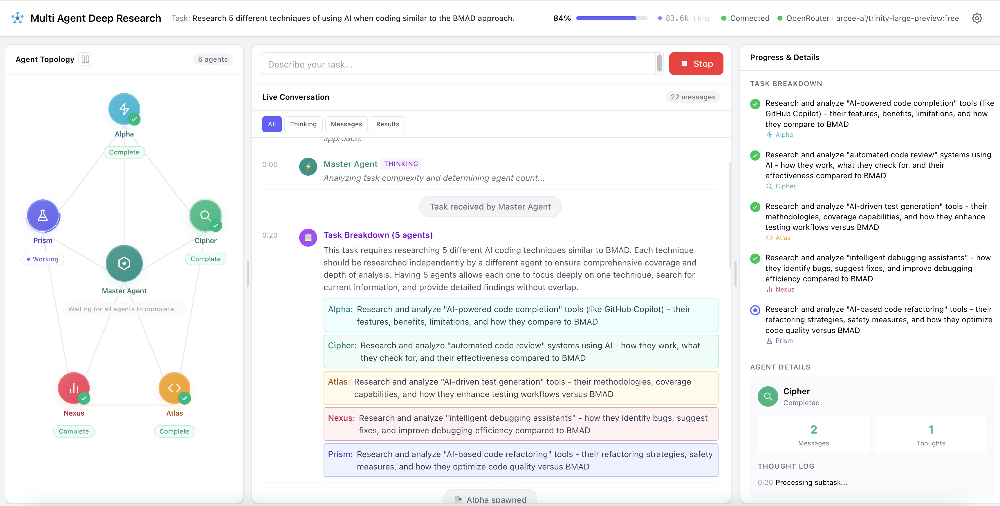
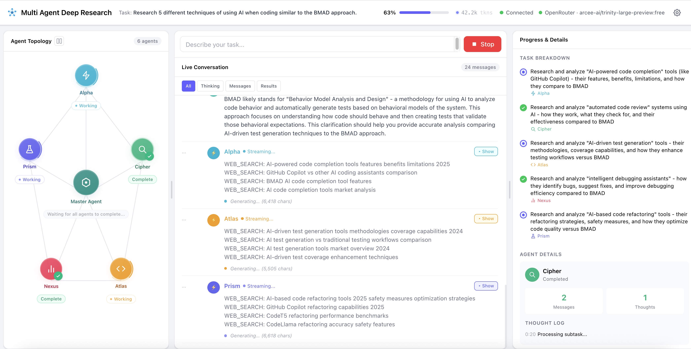

# Multi Agent Deep Research

A real-time multi-agent orchestration dashboard that breaks complex research tasks into subtasks, delegates them to specialized AI agents running in parallel, and synthesizes a unified result — all streamed live to an interactive three-panel UI.





---

## Features

### Multi-Agent Orchestration
- **Master Handler + Up to 5 Sub-Agents** — The Master Handler analyzes task complexity and dynamically spawns 1–5 specialized agents (Alpha, Cipher, Atlas, Nexus, Prism) with meaningfully distinct subtasks.
- **Parallel Execution** — All sub-agents work concurrently, with results streamed to the dashboard in real time.
- **Inter-Agent Communication** — Agents can ask questions to the Master Handler or to sibling agents mid-task using a structured `ASK_QUESTION_TO` protocol, with answers routed through a centralized communication bus.
- **Quality Evaluation & Follow-Up Rounds** — After the initial round, the Master Handler critically evaluates all outputs. If gaps are identified, it assigns up to 2 rounds of targeted follow-up tasks before final synthesis.
- **Final Synthesis** — The Master Handler combines outputs from all agents and all rounds into a single coherent response.

### Real-Time Web Search
- **Exa.ai Integration** — Agents can issue `WEB_SEARCH` commands during task execution to fetch current information from the internet.
- **Multi-Round Search** — Up to 3 search rounds per agent, with results injected back into the agent's conversation for incorporation.
- **Configurable Search Provider** — Search API keys and endpoints are managed through the Settings UI.

### Agent Self-Critique Scorecard
After each agent finishes streaming its response, it performs a structured self-evaluation before the results are forwarded to the Master Handler. This is an optional feature toggled from **Settings → System Prompt**.

**How it works:**
1. The agent reviews its own output and scores it on three dimensions (1–10 each): **Accuracy**, **Completeness**, and **Relevance**.
2. An **Overall score** (average of the three) is computed.
3. If Overall ≥ 6.5 → the response is kept and a scorecard is posted to the conversation feed.
4. If Overall < 6.5 → the agent automatically **rewrites and improves** its response, then self-scores again and posts a before/after comparison card.

**How it looks in the demo:**

```
┌── 🎯 Alpha · Self-Assessment  ───────────── ✓ Confident ──┐
│  Accuracy       ████████░░  8/10                        │
│  Completeness   ██████░░░░  6/10                        │
│  Relevance      █████████░  9/10                        │
│  Overall  7.7/10  “Could include more specific examples.”  │
└───────────────────────────────────────────────────┘
```

When the score falls below the threshold and a revision is made:

```
┌── ✨ Cipher · Revised Assessment ────── +2.3 improvement ─┐
│  Accuracy       4  →  8  ↑4                           │
│  Completeness   5  →  7  ↑2                           │
│  Relevance      6  →  7  ↑1                           │
│  Overall  5.0  →  7.3  ✓ Quality improved             │
└───────────────────────────────────────────────────┘
```

**Topology nodes** display a small colored score badge (green ≥ 7, amber ≥ 5, red < 5) next to each agent's name for an instant at-a-glance quality indicator.

**Toggle:** Settings → System Prompt tab → **Agent Self-Critique** switch. Defaults to enabled.

### Live Streaming Dashboard (React + Vite)
- **Three-Panel Resizable Layout** — Agent Topology (left), Live Conversation (center), Progress & Details (right), with drag-to-resize dividers and per-panel maximize/restore buttons.
- **Agent Topology Visualization** — Interactive node graph showing the Master Handler at the center connected to all active sub-agents, with:
  - Color-coded agent nodes with unique icons per agent
  - Real-time status badges (Working, Complete, etc.)
  - Animated lightning bolts along edges when agents communicate
  - Click-to-select for viewing agent details
  - Agent result preview popovers on hover
- **Live Conversation Feed** — Scrollable, auto-scrolling message stream with:
  - Filter tabs: All, Thinking, Messages, Results
  - Color-coded message bubbles per agent
  - Message type badges (STATUS, QUESTION, ANSWER, RESULT, etc.)
  - Timestamps on each message
  - Streaming message indicators with live character count
  - Collapsible/expandable streaming output with a Show/Hide toggle
  - Markdown rendering (via `marked` + `DOMPurify`) for agent outputs
- **Progress Sidebar** — Right panel displaying:
  - **Task Breakdown** — All subtasks with status checkmarks (pending, active, done) and assigned agent labels
  - **Agent Details** — Click an agent to see message count, thought count, thought log, and live output stream
- **Task Input Bar** — Top-center input with a Submit button that converts to a Stop button during processing, allowing graceful task cancellation.

### Header & Status Bar
- **Live Progress Bar** — Percentage-based progress indicator that fills as agents complete work.
- **Token Tracker** — Real-time token usage counter (prompt + completion tokens) displayed in the header, with an animated ping indicator during processing.
- **Connection Status** — Green/red dot showing WebSocket connection state.
- **Provider & Model Display** — Shows the active provider name and model (e.g., "OpenRouter · arcee-ai/trinity-large-preview:free").
- **Confetti Celebration** — Multi-burst confetti animation fires when a task reaches 100% completion.

### Multi-Provider Support
The application supports any OpenAI-compatible API endpoint, with built-in presets for:
- **OpenAI** (GPT-4o, etc.)
- **OpenRouter** (hundreds of models, free tier support)
- **DeepSeek**
- **Groq**
- **NVIDIA NIM**
- **Ollama** (local)
- **LM Studio** (local)
- **Strongwall**
- **AskCodi**
- **Any custom endpoint** via manual Base URL entry

Provider-specific features:
- Per-provider API key and model persistence in `data/config.json`
- Recent model tracking per provider
- OpenRouter model list fetching with free-model detection
- AskCodi model list fetching
- Local providers (Ollama, LM Studio) work without an API key
- Connection testing before saving configuration

### Settings Modal
- Provider preset dropdown for quick switching
- Editable Base URL, API Key, and Model fields
- **Test Connection** button with detailed error diagnostics (DNS, timeout, auth, rate-limit)
- Save & Close persists configuration to disk

### Robust Error Handling
- **Automatic Retry with Exponential Backoff** — Failed API calls retry up to 3 times with configurable delays (1s → 2s → 4s, capped at 10s).
- **Partial Failure Recovery** — If some agents fail, the system proceeds with available results and warns the user.
- **Graceful Task Stopping** — `TaskStoppedError` propagates cleanly through all agents, immediately halting parallel work.
- **WebSocket Auto-Reconnect** — The client automatically reconnects after 3 seconds if the connection drops.

---

## Tech Stack

| Layer | Technology |
|-------|-----------|
| **Backend** | Node.js, Fastify, @fastify/websocket |
| **Frontend** | React 19, Vite 8, Tailwind CSS 4 |
| **AI** | OpenAI-compatible chat completions API (streaming + non-streaming) |
| **Search** | Exa.ai real-time web search |
| **Real-Time** | WebSocket for bidirectional agent message streaming |
| **Rendering** | Marked (Markdown) + DOMPurify (sanitization) |
| **Effects** | canvas-confetti for task completion celebrations |

---

## Project Structure

```
agent-chat/
├── server.js                       # Fastify server, REST API, WebSocket handler
├── package.json                    # Backend dependencies
├── data/
│   └── config.json                 # Provider keys, models, search config (persisted)
├── src/
│   ├── agents/
│   │   ├── index.js                # Agent factory
│   │   ├── masterHandler.js        # Master Handler orchestration logic
│   │   ├── subAgent.js             # Sub-agent logic, communication bus
│   │   ├── openaiService.js        # OpenAI-compatible HTTP client (streaming + sync)
│   │   └── searchService.js        # Exa.ai web search integration
│   └── utils/
│       └── config.js               # Configuration management
├── client/                         # React frontend (Vite)
│   ├── package.json
│   ├── vite.config.js
│   ├── index.html
│   └── src/
│       ├── App.jsx                 # Three-panel layout with resize + maximize
│       ├── main.jsx                # React entry point
│       ├── index.css               # Global styles
│       ├── utils.js                # Markdown rendering, provider helpers
│       ├── components/
│       │   ├── Header.jsx          # App header, progress bar, token tracker
│       │   ├── TaskInput.jsx       # Task input bar with submit/stop
│       │   ├── AgentTopology.jsx   # Interactive agent node graph
│       │   ├── AgentIcons.jsx      # SVG icons for each agent
│       │   ├── ConversationFeed.jsx# Live message stream with filters
│       │   ├── ProgressSidebar.jsx # Task breakdown + agent details
│       │   ├── SettingsModal.jsx   # Provider configuration modal
│       │   ├── TokenTracker.jsx    # Real-time token usage display
│       │   └── messages/
│       │       └── StreamingMessage.jsx # Streaming text renderer
│       ├── context/
│       │   ├── OrchestrationContext.jsx # React context provider
│       │   └── orchestrationReducer.js  # State management reducer
│       └── hooks/
│           └── useWebSocket.js     # WebSocket hook + message dispatcher
├── plans/
│   └── architecture.md             # Architecture documentation
└── docs/
    ├── screenshot.jpg              # Application screenshot
    └── screenshot1.jpg             # Application screenshot (alternate view)
```

---

## Getting Started

### Prerequisites
- **Node.js 18+**
- An API key for at least one supported provider (or a local model server like Ollama)

### Installation

```bash
git clone https://github.com/sameer-coder/agent-chat.git
cd agent-chat

# Install backend dependencies
npm install

# Install frontend dependencies
cd client && npm install && cd ..
```

### Configuration

1. Open the app and click the **⚙ Settings** gear icon in the header.
2. Select a provider preset (e.g., OpenRouter, OpenAI, Ollama).
3. Enter your API key and model name.
4. Click **Test Connection** to verify, then **Save & Close**.

Configuration is persisted to `data/config.json`.

For web search, configure an [Exa.ai](https://exa.ai) API key in the search settings section.

### Running

```bash
# Start the backend server (port 3000)
npm start

# In a separate terminal, start the frontend dev server
npm run dev:client
```

Or run both together:

```bash
npm run dev:all
```

Then open **http://localhost:5173** (Vite dev server) or **http://localhost:3000** (production build).

### Production Build

```bash
npm run build     # Builds the React client into client/dist/
npm start         # Serves the built frontend + API from port 3000
```

---

## API Endpoints

| Endpoint | Method | Description |
|----------|--------|-------------|
| `/api/health` | GET | Health check + provider status |
| `/api/config` | GET/POST | Get or update active provider config |
| `/api/provider-config` | GET/POST | Per-provider key and model management |
| `/api/provider-config/key` | GET | Retrieve API key for a specific provider |
| `/api/test` | POST | Test connection to a provider |
| `/api/openrouter/models` | GET | Fetch available OpenRouter models |
| `/api/askcodi/models` | GET | Fetch available AskCodi models |
| `/api/search/config` | GET/POST | Get or update search provider config |
| `/api/search/test` | POST | Test search API connection |
| `/api/search` | POST | Execute a web search |
| `/api/self-critique/config` | GET/POST | Get or update Agent Self-Critique enabled flag |
| `/ws` | WebSocket | Real-time bidirectional agent communication |

### WebSocket Events

| Event | Direction | Description |
|-------|-----------|-------------|
| `task` | Client → Server | Submit a new research task |
| `stop` | Client → Server | Request graceful task cancellation |
| `connected` | Server → Client | Initial connection with config status |
| `agent-names` | Server → Client | Agent names and count for the task |
| `task-breakdown` | Server → Client | Subtask assignments with explanations |
| `streaming` | Server → Client | Streaming text chunks from agents |
| `stream-end` | Server → Client | Agent finished streaming |
| `agent-result` | Server → Client | Completed agent output (per round) |
| `agent-question` / `agent-answer` | Server → Client | Inter-agent Q&A messages |
| `web-search` / `web-search-done` | Server → Client | Search lifecycle events |
| `evaluation` | Server → Client | Master Handler quality evaluation |
| `follow-up-assignment` | Server → Client | Follow-up task assignments |
| `self-critique` | Server → Client | Agent self-evaluation scorecard (scores + will-revise flag) |
| `self-critique-revised` | Server → Client | Revised scorecard after automatic rewrite (before/after comparison) |
| `token-usage` | Server → Client | Token consumption updates |
| `complete` | Server → Client | Final synthesized result |
| `error` | Server → Client | Error notification |
| `stopped` | Server → Client | Task successfully cancelled |

---

## License

MIT
