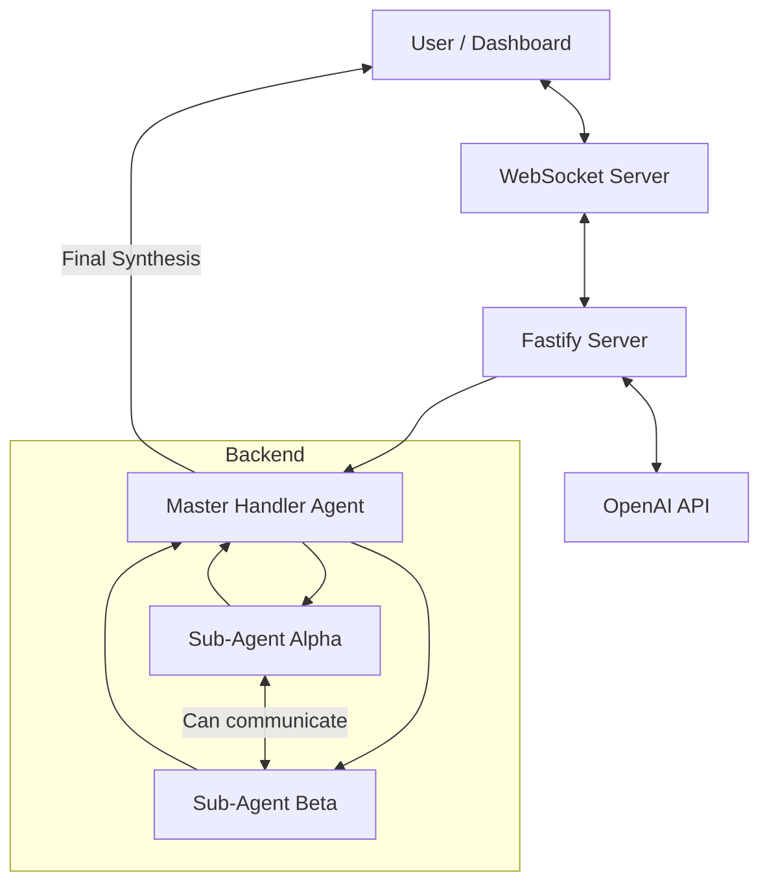

# Multi-Agent Dashboard Architecture

## System Overview

This dashboard implements a **three-agent system** where:
- **Master Handler Agent** - Orchestrates the entire task, breaks it into subtasks, and synthesizes results
- **Sub-Agent Alpha** - Receives and processes assigned subtasks
- **Sub-Agent Beta** - Receives and processes assigned subtasks
- **Dashboard** - Real-time visualization of agent conversations

## Technology Stack

- **Backend**: Node.js + Fastify + @fastify/websocket
- **Frontend**: Vanilla HTML/JS with Tailwind CSS (CDN)
- **AI**: OpenAI API (GPT models)
- **Real-time**: WebSocket for streaming agent messages

## Architecture Diagram



## Workflow

1. **Task Submission**: User submits a task via dashboard
2. **Task Analysis**: Master Handler analyzes the task and determines how to split it
3. **Sub-task Distribution**: Master Handler assigns subtasks to Sub-Agent Alpha and Sub-Agent Beta
4. **Agent Collaboration**: Sub-agents can communicate with each other to discuss their tasks
5. **Progress Updates**: All agent messages are streamed to the dashboard in real-time
6. **Result Synthesis**: When both sub-agents complete, Master Handler synthesizes their outputs
7. **Final Response**: Master Handler provides the final synthesized response to the user

## File Structure

```
/agent-chat
├── package.json
├── server.js                 # Fastify + WebSocket server
├── /src
│   ├── /agents
│   │   ├── index.js          # Agent factory and management
│   │   ├── masterHandler.js  # Master Handler agent logic
│   │   ├── subAgent.js       # Sub-agent logic
│   │   └── openaiService.js  # OpenAI API integration
│   └── /utils
│       └── config.js         # Configuration management
├── /public
│   ├── index.html            # Dashboard HTML with Tailwind
│   └── app.js                # Frontend JavaScript
└── .env                      # Environment variables (optional)
```

## API Endpoints

| Endpoint | Method | Description |
|----------|--------|-------------|
| `/api/task` | POST | Submit a task to the agents |
| `/api/config` | POST | Set OpenAI API key |
| `/ws` | WebSocket | Real-time agent communication |

## WebSocket Events

| Event | Direction | Description |
|-------|-----------|-------------|
| `task` | Client → Server | Submit new task |
| `message` | Server → Client | Agent message/update |
| `error` | Server → Client | Error notification |
| `complete` | Server → Client | Task completion notification |

## Agent Prompting Strategy

### Master Handler System Prompt
The Master Handler is configured to:
1. Analyze incoming tasks
2. Break complex tasks into 2 independent subtasks
3. Assign appropriate subtasks to each sub-agent
4. Monitor sub-agent progress
5. Synthesize sub-agent outputs into a coherent final response

### Sub-Agent System Prompt
Each Sub-Agent is configured to:
1. Receive and understand their assigned subtask
2. Work on the subtask independently
3. Communicate with other sub-agents when needed
4. Report progress and results back to Master Handler

## Security Considerations

- API key stored in memory only (not persisted)
- Environment variable fallback for API key
- Input sanitization for user tasks
- Rate limiting consideration for API calls
